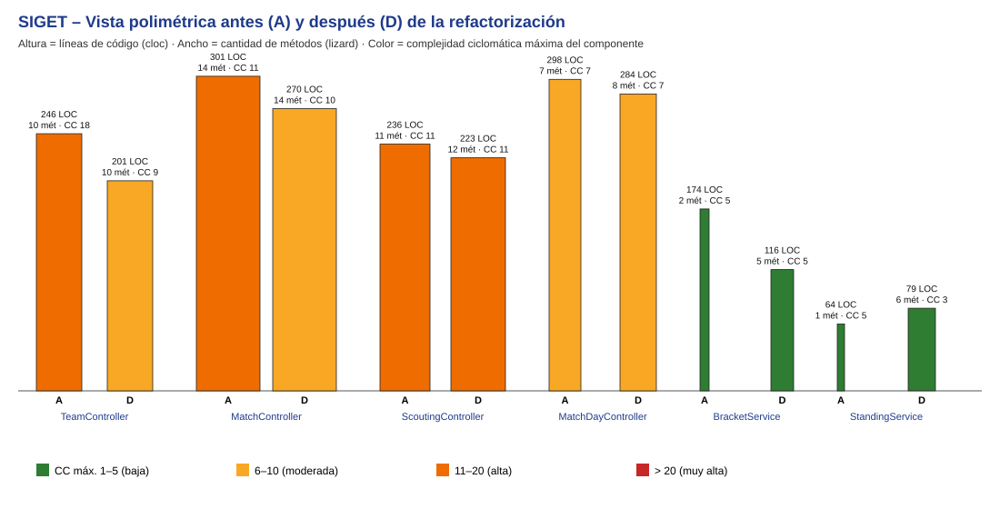

# MÉTRICAS DEL SOFTWARE – SIGET

**GUÍA PRÁCTICA N.º 11 – EVALUACIÓN, MÉTRICAS, CALIDAD Y MANTENIMIENTO DEL SOFTWARE**
**SIGET-SF – Sistema Integral de Gestión de Torneos Deportivos**

| | |
|---|---|
| **Integrantes** | Néstor Iván Granados Valenzuela · Nelly Fabiola Cano Oviedo |
| **Institución** | Fundación de Estudios Superiores Comfanorte (FESC) |
| **Programa** | Ingeniería de Software – V Semestre |
| **Asignatura** | Arquitectura y Diseño del Software – Unidad 3: Métricas del Software |
| **Docente** | Ing. Robinson Damián Gómez Sánchez |

> Las cifras salen de [`docs/evidencias/antes/`](evidencias/antes/) y [`docs/evidencias/despues/`](evidencias/despues/), medidas con el mismo script ([`scripts/analisis-calidad.sh`](../scripts/analisis-calidad.sh)), las mismas herramientas, la misma configuración y el mismo alcance (`src/app` y `src/routes`). El consolidado está en [`comparativo-metricas.json`](evidencias/comparativo-metricas.json).

---

## 1. Métricas iniciales

| Categoría | Métrica | Valor inicial |
|---|---|---|
| Tamaño | Líneas de código (LOC) | 6 909 |
| | Líneas de comentario | 478 |
| | Archivos PHP | 80 |
| | Métodos / funciones | 380 |
| Complejidad | CCN promedio por método | 2,62 |
| | CCN máxima | 18 (`TeamController::store`) |
| | Métodos con CCN 6–10 (moderada) | 31 |
| | Métodos con CCN 11–20 (alta) | 14 |
| | Métodos con CCN > 20 (muy alta) | 0 |
| | Métodos de más de 60 NLOC | 14 |
| Duplicidad | Clones / líneas duplicadas | 4 / 63 |
| | Porcentaje de duplicidad | 0,74 % (63 de 8 533 líneas físicas) |
| Diseño | Problemas PHPMD (`codesize`, `design`, `unusedcode`) | 43 |
| Calidad | Problemas PHPMD (`cleancode`, `naming`) | 173 |
| Estándares | PSR-12 (PHPCS) | 132 errores / 166 advertencias |
| | Archivos fuera del estilo Pint | 7 |
| Acoplamiento | CBO promedio por clase (PDepend) | 5,13 |
| | WMC máximo por clase | 51 (`ScoutingController`) |
| Seguridad | Vulnerabilidades npm | 4 (2 críticas, 2 altas) |
| | Vulnerabilidades en código propio | 4 (3 *open redirect*, 1 clave predecible) |
| Deuda técnica | Estimada | 50,9 h (índice 1,47 %) |

## 2. Métricas posteriores a la refactorización

| Categoría | Métrica | Valor final |
|---|---|---|
| Tamaño | LOC / comentarios / archivos / métodos | 6 880 / 529 / 80 / 399 |
| Complejidad | CCN promedio / máxima | 2,51 / 15 |
| | Métodos CCN 6–10 / 11–20 / > 20 | 30 / 12 / 0 |
| | Métodos de más de 60 NLOC | 11 |
| Duplicidad | Clones / porcentaje | 0 / 0,00 % |
| Diseño | Problemas PHPMD de diseño | 32 |
| Calidad | Problemas PHPMD de calidad | 162 |
| Estándares | PSR-12 / Pint | 129 errores, 164 advertencias / 0 archivos |
| Acoplamiento | CBO promedio / WMC máximo | 5,26 / 44 |
| Seguridad | npm / código propio | 0 / 0 |
| Deuda técnica | Estimada | 37,1 h (índice 1,08 %) |

## 3. Tabla comparativa de resultados

| Métrica o indicador | Antes | Después | Variación |
|---|---:|---:|---:|
| Líneas de código | 6 909 | 6 880 | −29 (−0,4 %) |
| Cantidad de archivos | 80 | 80 | 0 (+1 servicio nuevo, −1 stub eliminado) |
| Cantidad de métodos | 380 | 399 | +19 (+5,0 %) |
| Complejidad ciclomática promedio | 2,62 | 2,51 | −0,11 (−4,2 %) |
| Complejidad ciclomática máxima | 18 | 15 | −3 |
| Métodos con complejidad alta (CCN > 10) | 14 | 12 | −2 (−14,3 %) |
| Métodos con advertencia (CCN > 10 o > 60 NLOC) | 25 | 21 | −4 (−16,0 %) |
| Porcentaje de duplicidad | 0,74 % | 0,00 % | −0,74 pp (−100 %) |
| Clones de código | 4 | 0 | −4 |
| Problemas de calidad (PHPMD cleancode/naming) | 173 | 162 | −11 (−6,4 %) |
| Problemas de diseño (PHPMD) | 43 | 32 | −11 (−25,6 %) |
| Incumplimiento de estándares PSR-12 (errores + advertencias) | 298 | 293 | −5 (−1,7 %) |
| Incumplimiento del estilo del proyecto (Pint) | 7 archivos | 0 archivos | −7 (−100 %) |
| Posibles vulnerabilidades (npm + código propio) | 8 | 0 | −8 (−100 %) |
| Deuda técnica estimada | 50,9 h | 37,1 h | −13,8 h (−27,0 %) |
| Pruebas automatizadas | 76 | 107 | +31 |
| Pruebas aprobadas sin assets de Vite (como en CI) | 52 / 76 | 107 / 107 | +55 |

### Detalle de los problemas de diseño (PHPMD)

| Regla PHPMD | Antes | Después | Variación |
|---|---:|---:|---:|
| CyclomaticComplexity | 16 | 14 | −2 |
| NPathComplexity | 7 | 6 | −1 |
| ExcessiveMethodLength | 5 | 3 | −2 |
| ExcessiveClassComplexity | 1 | 0 | −1 |
| UnusedFormalParameter | 3 | 0 | −3 |
| UnusedLocalVariable | 2 | 0 | −2 |
| TooManyPublicMethods | 5 | 5 | 0 |
| CouplingBetweenObjects | 3 | 3 | 0 |
| NumberOfChildren | 1 | 1 | 0 |
| **Total** | **43** | **32** | **−11** |

## 4. Interpretación de las variaciones

- **Complejidad.** El método más complejo del sistema, `TeamController::store`, bajó de CCN 18 a 4 al pasar la lógica del DT a `TeamDirectorAssignmentService`. El promedio bajó de 2,62 a 2,51 aunque hay 19 métodos más: la lógica se repartió en métodos pequeños. La **suma** total de CCN subió un poco (994 → 1 002) porque cada método nuevo agrega un camino de entrada; es lo esperado al extraer métodos y no significa más lógica. La CCN máxima ahora es 15 y está en tres componentes que no se intervinieron (`FixtureGeneratorService::preview`, `ScheduleService::validateMatchConstraints`, `SportsChronicleService::generateAlgorithmicChronicle`); les sigue `PlayerController::index` con 14 (bajó de 15 al centralizar los roles). Quedan registrados como deuda en [MANTENIMIENTO.md](MANTENIMIENTO.md).
- **Duplicidad.** Pasó de 0,74 % a 0 %. El porcentaje inicial ya era bajo, pero los cuatro clones estaban en zonas sensibles (filtros públicos y administrativos, feed en vivo, llaves eliminatorias), donde una corrección aplicada en un solo lado produce comportamientos distintos.
- **Tamaño.** Las LOC casi no cambiaron (−29): se eliminó código duplicado y muerto, pero se agregaron documentación (comentarios +51), un servicio nuevo y validaciones de seguridad. En `BracketService` la lógica efectiva (ELOC, PDepend) bajó de 162 a 87 líneas.
- **Diseño.** Los 11 problemas de diseño menos corresponden a complejidad, longitud de métodos y código sin uso, que eran los que la refactorización atacaba. `TooManyPublicMethods` y `CouplingBetweenObjects` no cambiaron porque afectan a modelos Eloquent (`MatchGame`, `Player`, `Team`) cuyas relaciones son métodos públicos por diseño del framework.
- **Acoplamiento.** El CBO promedio subió levemente (5,13 → 5,26). PDepend cuenta cada tipo importado: los nuevos *type hints* (`Builder`, `Collection`, `User`) y el servicio inyectado suman dependencias, pero hacia abstracciones del framework y no entre clases de negocio. Sí bajó el acoplamiento que importa: los controladores ya no dependen de las cadenas literales `'super_admin'`/`'admin'` (27 apariciones → 0) y `TeamController` pasó de CBO 11 a 10.
- **Estándares.** El proyecto usa **Laravel Pint** como estándar y quedó en cumplimiento total (7 → 0 archivos). En PSR-12 la mejora es pequeña (298 → 293): 120 de las violaciones restantes son de espaciado del operador de concatenación (`'a'.$b`), que el preset de Laravel escribe así a propósito y PSR-12 marca. No se "corrigieron" porque contradirían el estándar adoptado. El resto son advertencias de longitud de línea.
- **Seguridad.** Se eliminaron las 4 vulnerabilidades de dependencias y los 4 puntos vulnerables del código (CWE-601 y CWE-1393). Las pruebas CP-06, CP-07 y CP-09 fallaban antes y ahora aprueban.
- **Deuda técnica.** Bajó un 27 %, sobre todo por menos problemas de diseño, la eliminación de clones y la corrección de las vulnerabilidades.

## 5. Deuda técnica estimada

SonarQube no estuvo disponible, así que la deuda se estimó con un modelo de costo de remediación similar a SQALE: cada hallazgo de las herramientas se multiplica por un tiempo de corrección. El índice de deuda se calcula como *deuda ÷ costo de desarrollo*, con un costo de 30 minutos por línea (el valor por defecto de SonarQube). Detalle en [`deuda-tecnica.json`](evidencias/deuda-tecnica.json).

| Tipo de hallazgo | Minutos por hallazgo | Antes (cant. → min) | Después (cant. → min) |
|---|---:|---:|---:|
| PSR-12 corregible automáticamente | 1 | 131 → 131 | 128 → 128 |
| PSR-12 manual (longitud de línea, etc.) | 2 | 167 → 334 | 165 → 330 |
| PHPMD diseño | 30 | 43 → 1 290 | 32 → 960 |
| PHPMD cleancode/naming | 5 | 173 → 865 | 162 → 810 |
| Clon de código | 30 | 4 → 120 | 0 → 0 |
| Archivo fuera del estilo Pint | 2 | 7 → 14 | 0 → 0 |
| Vulnerabilidad npm | 15 | 4 → 60 | 0 → 0 |
| Vulnerabilidad en código propio | 60 | 4 → 240 | 0 → 0 |
| **Total** | | **3 054 min ≈ 50,9 h** | **2 228 min ≈ 37,1 h** |
| **Índice de deuda** (deuda ÷ LOC × 30 min) | | **1,47 %** | **1,08 %** |

## 6. Representación polimétrica

Cada componente se dibuja como un rectángulo: **altura = líneas de código**, **ancho = cantidad de métodos** y **color = complejidad ciclomática máxima** (verde 1–5, amarillo 6–10, naranja 11–20, rojo > 20). Para cada componente, **A** es el estado antes y **D** el estado después.

| Componente | LOC (A → D) | Métodos (A → D) | CCN máx. (A → D) | WMC (A → D) | CBO (A → D) | Lectura |
|---|---|---|---|---|---|---|
| `TeamController` | 246 → 201 | 10 → 10 | **18 → 9** | 49 → 34 | 11 → 10 | Pasa de naranja (alta) a amarillo: el registro de equipos salió del controlador. |
| `MatchController` | 301 → 270 | 14 → 14 | 11 → 10 | 48 → 44 | 14 → 14 | Más bajo (−31 LOC) al delegar los filtros en `MatchGame::scopeFilter()`. |
| `ScoutingController` | 236 → 223 | 11 → 12 | 11 → 11 | 51 → 42 | 8 → 10 | Bajó el WMC; sigue naranja por `recruitmentRequests()` (pendiente). |
| `MatchDayController` | 298 → 284 | 7 → 8 | 7 → 7 | 21 → 22 | 9 → 9 | Un método más (`matchStatePayload`) y −14 LOC sin el bloque duplicado. |
| `BracketService` | 174 → 116 | 2 → 5 | 5 → 5 | 6 → 9 | 5 → 6 | Pasa de una barra alta y angosta (método de 178 líneas) a una más baja y ancha. |
| `StandingService` | 64 → 79 | 1 → 6 | 5 → 3 | 5 → 9 | 4 → 6 | Más ancho y de menor complejidad: un método largo dividido en seis métodos de una sola responsabilidad. |

## 7. Conclusiones sobre la calidad del código fuente

1. SIGET partía de una base sana en promedio (CCN 2,62, duplicidad 0,74 %), pero con **puntos críticos concentrados**: unos pocos métodos muy grandes y varios fragmentos copiados entre la versión pública y la administrativa.
2. Las métricas **sirvieron para encontrar defectos reales**, no solo problemas de estilo. Revisar el método más complejo (`TeamController::store`) llevó a dos vulnerabilidades, y revisar el método largo de `StandingService` llevó a una regla de negocio que no se aplicaba.
3. Tras la refactorización bajaron la complejidad máxima (18 → 15), la duplicidad (→ 0 %), los problemas de diseño (−25,6 %), las vulnerabilidades (8 → 0) y la deuda técnica (−27 %), **sin cambiar el comportamiento**: las 76 pruebas originales siguen aprobando y se agregaron 31.
4. No todas las métricas debían bajar: el número de métodos y el CBO subieron un poco como consecuencia esperada de extraer métodos y tipar dependencias. A cambio, el código es más fácil de probar y de entender.
5. La deuda que queda está identificada y priorizada en [MANTENIMIENTO.md](MANTENIMIENTO.md), empezando por los tres métodos con CCN 15 y `PlayerController::index` (CCN 14).
